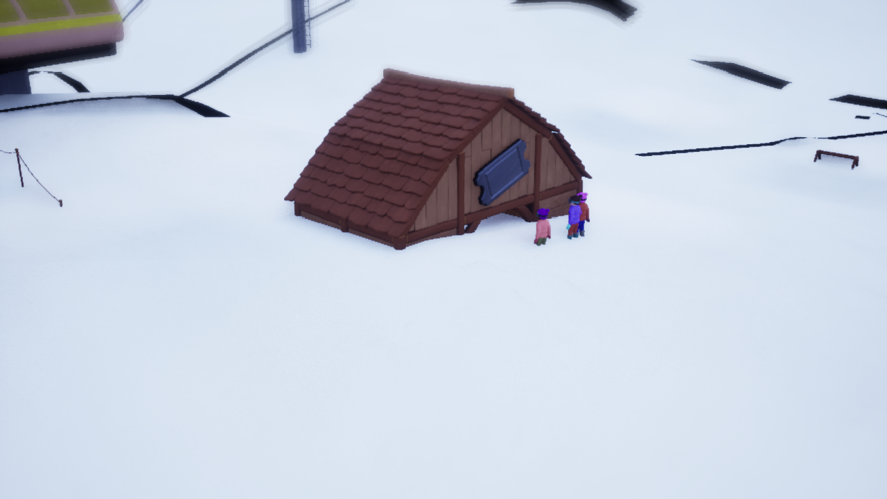
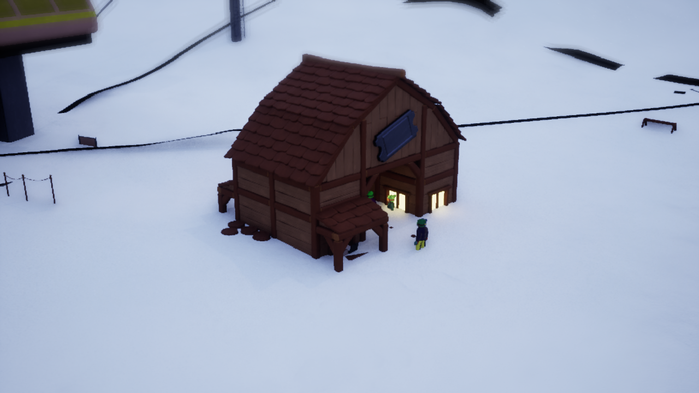
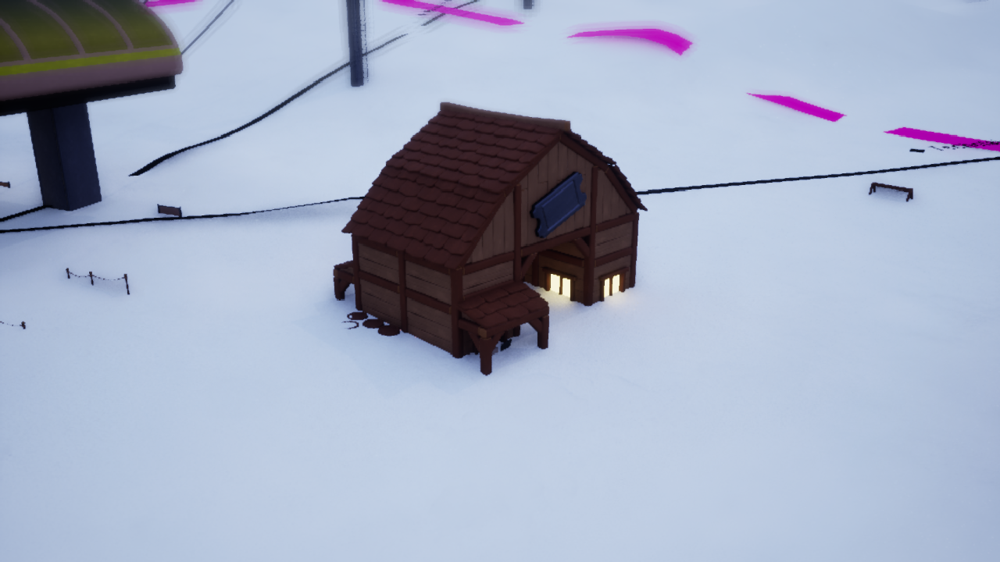

# Bâtiments sous la neige — 1.24.2

L'analyse du 18 octobre 2026 porte sur la démo Steam **26019240**, branche
`experts_only`. Son exécutable et son conteneur de ressources ont les mêmes
empreintes que lors de l'essai 1.24.1. Aucun autre numéro de correction du
développeur n'a été identifié ; ces résultats concernent le build installé.

## Défaut reproduit

La même billetterie de Super Saint-Bernard est observée avant sauvegarde et
après chargement depuis le menu natif. Sa position reste identique et le cache
de neige natif indique **100 cm de neige tassée + 20 cm de fraîche** dans les
deux cas. Pourtant, après reprise, la surface masque le rez-de-chaussée et ne
laisse presque que le toit visible.

La carte native Sugar Bowl sert de témoin : une épaisseur de 120 cm y masque
aussi une partie du bas d'un bâtiment, dont l'origine reste au sol. Relever
tous les bâtiments de la profondeur de neige ne reproduirait pas ce
comportement et les ferait flotter à la fonte.

Les essais isolent le défaut de reprise :

- Masquer la couche de neige révèle le bâtiment complet.
- Changer le matériau de neige pour celui des chunks natifs ne corrige pas l'écart.
- Rafraîchir les protections de neige des toits ne le corrige pas non plus.
- Neutraliser temporairement `BrushDeltaRT` fait réapparaître la billetterie.
- Recalculer ses empreintes de terrassement avec la méthode native, à sa
  position finale, corrige l'écart sans effacer ce render target.

Ces manipulations restent dans une copie du jeu avec son propre préfixe Proton
et ses sauvegardes. La neutralisation du render target sert uniquement au
diagnostic.

## Correction

Le moteur crée les empreintes de terrassement avant que la reconstruction du
terrain source et l'alignement final des objets soient terminés. La surface
de neige utilise encore ces anciennes déformations après la reprise.

Le chargeur réenregistre les empreintes après l'alignement des objets et la
restitution des origines sauvegardées des remontées. Il appelle la méthode
native de placement, qui remplace l'empreinte du même objet. Il détruit d'abord
les anciens composants temporaires par la méthode native de nettoyage : sans
cette étape, les appels successifs les dupliquent. Il ne vide ni
`BrushDeltaRT`, ni les couches de sculpture du joueur, ni la neige sauvegardée.
Le même rafraîchissement suit le recalage d'un nouveau bâtiment construit en
partie.

Les contrôles réfléchis vérifient les champs utilisés. Le pont natif accepte
uniquement les empreintes exactes des **2 088 octets** d'enregistrement et
des **267 octets** de nettoyage revus pour 25996759 et 26019240 ; toute
différence est refusée avant le premier nettoyage. Un lot
valide tous ses propriétaires avant de modifier la première empreinte.

La reconstruction peut aussi laisser le mémo de skiabilité natif sur une
lecture antérieure du terrain. Le diagnostic de Veymont reproduit neuf
libellés « No snow to ski » qui redeviennent « Operating » dès l'invalidation
du mémo. Le chargeur répète cette invalidation sur quatre lectures disponibles
du cache de neige, avec une limite de vingt tentatives. Il conserve le calcul
natif de skiabilité ; il ne force aucun résultat positif.

Un blocage de relance a également révélé une erreur de détection de Steam :
un client ouvert depuis longtemps pouvait être déclaré indisponible lorsque
son marqueur de démarrage sortait des 64 derniers Kio du journal. Le contrôle
parcourt maintenant le journal sans conserver son contenu et vérifie toujours
le PID vivant et la date du dernier démarrage.

## Contours noirs

Le terme « ruban noir » désignait les larges bandes sombres visibles autour
des zones de station. Le diagnostic change la couleur des anneaux de hubs
en magenta : les mêmes bandes deviennent magenta. Leur matériau natif emploie
une couleur presque noire. Il était donc incorrect de les présenter comme
une preuve de matériau cassé. Les panneaux de difficulté Expert sont aussi
noirs par choix du jeu.

La couleur et la qualité de la géométrie restent deux vérifications distinctes.
Le diagnostic de couleur ne valide pas à lui seul le tracé ou l'occultation.

## Validation

La qualification finale de **1.24.2 / build 26019240** est **compatible** :
**45 contrôles passants**, aucun échec. Les **275 tests Python** passent
(un test Qt ignoré faute de PySide6), ainsi que les **72 scripts Lua**.

Les deux slots natifs, Super Saint-Bernard **0.2.4** et Veymont **0.7.7**,
sont écrits puis repris depuis le menu. Les GUID, positions, noms, variantes,
effectifs, finances, état Lua, remontées et neige des terminaux sont identiques
avant/après. La suppression d'un banc par carte et le renommage d'un rack sont
conservés. Les vingt objets restants de Super Saint-Bernard et les soixante-quinze
de Veymont passent la comparaison stricte, après GC également.

Huit vues actives couvrent les bâtiments, le mobilier, les panneaux et le
relief des deux cartes. La billetterie conserve exactement son origine lors
des essais **0 / 120 / 300 / 120 cm** de neige. Un bâtiment nouvellement créé
est recalé et ses empreintes sont reconstruites par le callback de production.
Trois reconstructions supplémentaires gardent **un** composant de terrassement
et **un** bloqueur, sans duplication. La simulation reprend ensuite normalement,
avec des visiteurs au sol et des remontées opérationnelles.

Le protocole et les tolérances restent ceux de
[la qualification du jeu](game-compatibility-testing.md) : **1 cm** pour les
positions et **0,5 cm** pour la neige. Les rapports de cette reprise sont conservés dans
`build/compatibility/26019240-snow-1.24.2-final/` et les essais de diagnostic dans
`build/snow-support-26019240/`. Le build 26019240 est désormais annoncé dans
les métadonnées de compatibilité du chargeur.
