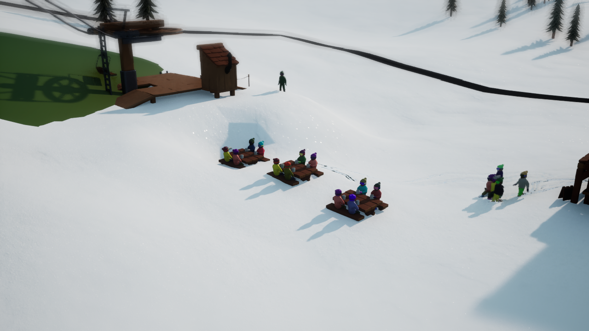

# Neige flottante sur les cartes personnalisées — 1.24.8

Le signalement décrit des visiteurs sous la neige, du mobilier enfoui et des
traces invisibles sur les cartes personnalisées. Sans les captures ni la version
du mod du rapport initial, les essais utilisent les cartes publiques actuelles
et la démo Steam **26097896**. Deux défauts distincts sont reproduits.

## Relief visible et simulation

Le terrain visible et sa collision utilisent une grille simplifiée avec un
raffinement des falaises. Le cache natif, la neige et les terrassements reprenaient
les détails du R16 d'origine, y compris ceux omis par cette grille. Le sol de
simulation pouvait donc passer au-dessus ou au-dessous du relief visible.

Sur **Kitzbühel 0.1.2**, le R16 est échantillonné tous les 10 m et la grille visible
tous les 20 m avant raffinement. Au point `(-149000, -131000)` en centimètres,
le relief visible est environ **2,73 m** au-dessus du relief source interpolé.
Cet écart existe avant toute accumulation de neige.

Les caches natifs sont maintenant calculés à partir des triangles réellement
rendus, avec leurs falaises et raccords. Les requêtes d'altitude, les pistes et
les objets partagent cette surface. La grille native conserve sa résolution :
son interpolation peut encore différer légèrement aux changements de pente.
Les archives et le R16 des auteurs restent intacts.

Le nouveau format de travail transmet le plan de triangulation au helper natif.
Celui-ci valide toutes les données et prépare les textures avant de remplacer
le cache actif. Une entrée invalide laisse ce cache intact.

## Déformation autour des installations

Un second essai place trois tables de pique-nique près d'un bâtiment et d'une
remontée sur Kitzbühel. Avec seulement **20 cm** de neige, une table disparaît
et les visiteurs assis n'en dépassent que par la tête. Le cache de sol corrigé
ne suffit donc pas à résoudre tout le problème.

Le matériau natif applique les terrassements aux sommets du maillage de neige.
Sur de grands triangles, une déformation locale s'étend trop loin. La correction
raffine la neige autour des bâtiments et des points d'appui des remontées,
au chargement et après une construction. Les nouveaux sommets restent sur le
relief visible d'origine : augmenter leur nombre ne réintroduit pas les détails
omis du R16. Le budget ajouté est limité et les demandes répétées sont regroupées.
Les sections voisines sont reprises pour conserver des raccords continus.

Les terrassements, les outils de neige et la hauteur des bâtiments continuent
d'utiliser le comportement natif. Les anciennes sections de neige Nanite
concernées cèdent leur place au maillage procédural raffiné.

## Sauvegardes et vérifications

Les anciennes sauvegardes conservent leurs objets et leur état. Les bâtiments
auparavant ancrés sur un détail source omis sont recalés verticalement sur le
relief visible. Sur la sauvegarde témoin du build **26040817**, trois bâtiments
commerciaux sont ainsi corrigés d'environ **+54,40 cm**, **−9,62 cm** et
**+21,37 cm**. Ces déplacements correspondent exactement à l'écart mesuré entre
les deux surfaces ; les positions XY, identifiants, noms et variantes sont
contrôlés séparément.

Les **297 tests Python et 80 scripts Lua** passent, avec un test Qt optionnel
ignoré. L'oracle du sampler natif utilise les triangles produits par le vrai
constructeur Lua : intérieurs, bords, raccords, cellules partielles, ordre des
lignes et boutisme sont comparés. Les quinze essais Windows/Proton du helper
livré couvrent les deux anciens formats, les nouveaux plans et les données
malformées, avec conservation du cache en cas de refus.

La campagne finale utilise une copie isolée du jeu et des sauvegardes de test.
Elle est pilotée par UE4SS dans un affichage hors écran ; les captures du jeu et
de l'interface sont demandées au moteur, sans activation d'une fenêtre du bureau.
Les preuves sont conservées sous
`build/compatibility/26097896-1.24.8-snow-final-v3/` et
`build/flying-snow/native-jobs-v3/`.

La qualification finale est **compatible : 46 contrôles sur 46 passent**.
Super Saint-Bernard et Veymont passent les vraies sauvegardes natives et leur
reprise, avec respectivement 20 et 75 objets contrôlés. Le cycle de neige
0 / 120 / 300 / 120 cm, la construction, les terrassements répétés, le catalogue,
les options et le sandbox passent également. La sauvegarde du build 26040817
conserve son état et ses 20 objets, avec les trois corrections de hauteur
mesurées ci-dessus.

Sur Kitzbühel, les trois tables et leurs occupants restent visibles à 20 cm de
neige après la correction. À 120 cm, les plateaux sont recouverts par la vraie
accumulation ; à 0 cm, ils sont à nouveau entièrement dégagés.

## Textures HD et résolution des altitudes

L'archive publique 0.1.2 fournit une texture de couleur standard de **512 × 512**
pixels pour les 8 × 8 km. Son dossier `HDTerrain` contient **10 × 10 tuiles de
512 × 512** pixels couvrant chacune 800 × 800 m, soit l'équivalent d'une image
5120 × 5120. Ce sont des images de surface ; le fichier d'altitudes reste
`Terrain/heightmap.r16`, avec **801 × 801** valeurs espacées de 10 m.

Le `sample_step` de 2 donne principalement un maillage visible à 20 m, complété
par le raffinement des falaises. Les tuiles de couleur ne changent pas cette
géométrie. Les essais décrits ici utilisent skieomod sans le mod HD optionnel ;
celui-ci n'est pas une dépendance déclarée de l'archive. Un essai séparé avec
HDTerrain chargé normalement confirme l'application des 100 tuiles. Voir
[l'analyse et la généralisation à toutes les couches](tiled-terrain.md) pour
les limites relevées et le travail restant.
